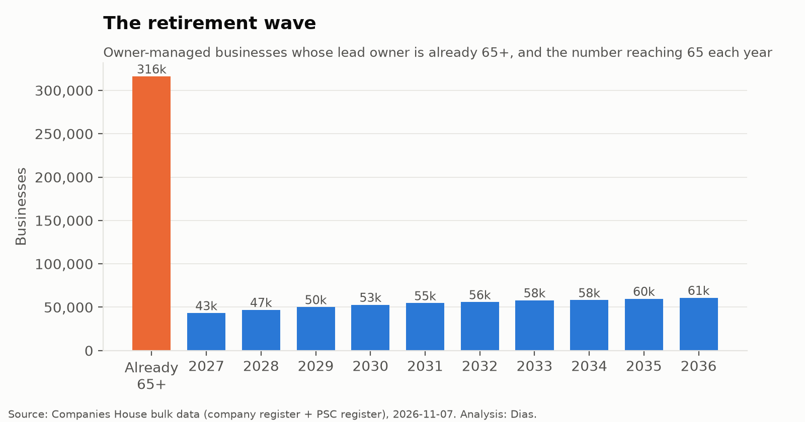

# The UK Succession Crisis

**How many UK businesses are run by owners nearing retirement, where are they, and how many jobs depend on them?**

Many UK small businesses were founded by baby boomers who are now in their 60s and 70s. When an owner retires without a successor, the business is either sold (often to private equity or a "search fund") or simply closes. This project measures the size of that "silver tsunami" using the **entire** UK company register, not a survey sample.

## Key findings (Companies House snapshot, 7 November 2026)

- **316,184** owner-managed UK businesses (**14%**) have a lead owner aged **65+** (160,502 aged 70+)
- **541,000** more owners turn 65 in the next ten years
- Most exposed: **agriculture (30%)**, mining, manufacturing; the **South West** and **Wales**. Least exposed: **London (11%)**
- **41%** of medium & large owner-managed firms have a 65+ owner, compared with 12% of micro firms
- **81%** of these businesses have no secured debt
- About **1.8 million jobs** (95% CI 1.2–2.4m) depend on them, roughly 5% of UK employment

📄 **Full report:** [`report/UK Succession Crisis - Report.pdf`](report/UK%20Succession%20Crisis%20-%20Report.pdf)

## About this project

The Python code was written by an AI assistant (Claude). I selected the topic, ran the analysis, tested the results at a different age cut-off, and interpreted the findings with AI support.

## Data

Both sources are free from Companies House:

| Source | What it gives |
|---|---|
| Basic Company Data (monthly bulk file) | Every UK company: status, type, sector (SIC), postcode, accounts type, incorporation date, outstanding charges |
| People with Significant Control (PSC) snapshot | Every company's owners (anyone with 25%+ of shares or control), including month & year of birth |
| Companies House API + iXBRL accounts | Employee counts for a random sample (jobs estimate only) |

## Method

1. **Universe**: active private limited companies that are trading. That excludes dormant, non-trading and subsidiary-exempt companies, companies with no accounts filed, and companies under 2 years old.
2. **Owner-managed**: at least one individual owner and **no** corporate owner.
3. **Lead owner**: the individual with the largest shareholding band (75%+, then 50%+, then 25%+). Ties go to the older owner.
4. **At risk**: lead owner aged **65+** (also reported for 70+).
5. **Operating businesses**: owner-managed companies, **excluding real estate** (mostly property-holding vehicles, not employers).
6. **Retirement wave**: the number of lead owners turning 65 in each of the next 10 years.
7. **Jobs at stake**: a simple random sample of 150 at-risk companies per size group, with employees read from their latest digital accounts. The sample mean is scaled to the population, and 95% confidence intervals come from 5,000 bootstrap resamples.

## How to run

1. Double-click **`Run Analysis.command`**. The first time, right-click it → Open.
2. The first run downloads about 3 GB, which takes roughly 30–60 minutes in total. Later runs reuse the processed data.
3. The jobs estimate uses the Companies House API key from `api_key.txt`, or from `../Financial Screener/api_key.txt` if there isn't one here.

Results go to `output/`:

- `summary.json`: the headline numbers
- `tables/*.csv`: the results by sector, region, size, company age, and the retirement wave
- `charts/*.png`: publication-ready charts
- `jobs_estimate.json`: the sample-based employment estimate

## Limitations

- **A PSC isn't always the person running the business.** Ownership ≠ management, and owners may have already planned a succession (e.g. family members). Age 65+ measures *exposure*, not certain closure.
- **Only companies are covered.** Sole traders and partnerships (most UK businesses by count) aren't on the register, so this understates the issue.
- **Region is approximate.** It's based on the registered-office postcode area, which is sometimes an accountant's address and isn't precise for a few border areas.
- **The jobs estimate can only use companies that file digital (iXBRL) accounts.** Paper filers are excluded, which may bias the estimate.
- **Excluding companies with a corporate owner can miss holding-company structures.** Some of these are owned by an individual through a holding company.

## Files

| File | Purpose |
|---|---|
| `run_analysis.py` | Runs the whole pipeline (settings at the top) |
| `succession/download.py` | Downloads the bulk files, with resume |
| `succession/build.py` | Streams ~5m companies and ~10m owner records into one table |
| `succession/analyse.py` | Headline numbers, tables and charts |
| `succession/jobs.py` | Sample-based jobs-at-stake estimate with bootstrap CIs |
| `succession/lookups.py` | Sector, region and size mappings |
| `succession/ch_client.py`, `ixbrl.py` | API client and accounts parser (reused from the Financial Screener) |

---
Contains public sector information licensed under the Open Government Licence v3.0. Results are published only as aggregates; no individual-level owner data is included in this repository.
